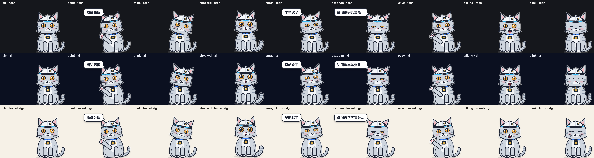

# REPORT — v2-B 晶片貓 VTuber 式角色（分層 SVG rig＋程式驅動）

## TL;DR

- 分支 `feat/explainer-v2-mascot`（從 `3332fa4` 開），本機 commit，**未 push**。`scripts/mascot_overlay.py --run-dir` 把 `assembly/draft.mp4` 疊上會呼吸、眨眼、對嘴、換姿勢的晶片貓，輸出 `assembly/final.mp4`。`timeline_assembly.py` 沒有改。🟢
- 驗收輸入用 trial 的複本，產物在 `output/explainer-tsmc-trial/assembly/final.mp4`（123.8 s，3713 幀）。三張截圖放在 `docs/examples/mascot/frame_{talking,point,deadpan}.png`，角色總覽圖是 `character_sheet.png`。🟢
- 效能（2 分鐘片）：4 workers 總共 134 s（渲染 110 s、疊加 24 s）；8 workers 126 s。換算 10 分鐘片約 11 分鐘（🟡 線性外推，沒有實測 10 分鐘）。🟢
- 決定性：4 workers 和 8 workers 的 final.mp4 逐幀 MD5 完全相同。途中抓到並修掉一個 Chromium 部分重繪造成的非決定性 bug，詳見〈決定性〉一節。🟢
- pytest：`1 failed, 769 passed`。唯一的失敗是基準既有的 `test_multi_provider…test_returns_first_provider_results`；不含我新增的檔案時是 `1 failed, 733 passed`，我新增了 36 個測試。🟢

等級：🟢 本機實測可重跑；🟡 只驗到存在或是推論；🔴 未驗證。

## 位置

- worktree：`/Users/lileon/project/content-farm/.claude/worktrees/cf-v2-mascot`
- 分支：`feat/explainer-v2-mascot`（本機，未 push）
- final.mp4：`/Users/lileon/project/content-farm/.claude/worktrees/cf-v2-mascot/output/explainer-tsmc-trial/assembly/final.mp4`（`output/` 在 gitignore 裡，沒有 commit）

| 路徑 | 內容 |
|---|---|
| `src/content_farm/explainer/mascot/params.py` | 參數名稱（Live2D 慣例）、中性值、7 種姿勢的目標表 |
| `…/mascot/idle.py` | 呼吸、眨眼排程、頭部漂移與偶發擺頭、耳朵抖動排程（全部用 seed 決定） |
| `…/mascot/physics.py` | 彈簧阻尼跟隨器，固定步長，每幀 8 個子步 |
| `…/mascot/lipsync.py` | 音訊 → 每幀 RMS dBFS → 門檻 → 正規化 → attack/release 平滑 → 靜音閉嘴 |
| `…/mascot/cues.py` | 每張投影片的時間（`visual/` 檔名，備援是 `scene_NNN.mp3` 的長度）和姿勢（deck.json，備援是 script.json） |
| `…/mascot/motion.py` | **確定性時鐘**：`compose_frames(cues, mouth, fps, n, seed)` 產出每幀的參數 dict |
| `…/mascot/assets/rig.html` | 分層 SVG 角色加上 `applyParams(p, say)`，沒有動畫也沒有計時器 |
| `…/mascot/render.py` | Playwright 逐幀截圖 → ffmpeg → ProRes 4444 alpha `.mov`，可以多個 process 平行處理 |
| `…/mascot/overlay.py` | 版面幾何（禁止區域）和 ffmpeg overlay 指令 |
| `…/mascot/run.py`、`scripts/mascot_overlay.py` | run-dir 串接和 CLI |
| `scripts/mascot_sheet.py` | 重產角色總覽圖 |
| `src/content_farm/explainer/deck.py` | `Mascot` 新增 `say`（≤20 字）和 `position`；`pose` 改成封閉集合（7 種） |
| `tests/unit/test_mascot_motion.py`（32 個）、`test_mascot_render.py`（4 個） | 見〈測試〉 |

## 角色設計



（`docs/examples/mascot/character_sheet.png`：7 種姿勢加上說話、眨眼，分別放在 tech、ai、knowledge 三套主題底色上）

- **造型**：銀灰色虎斑貓（矽晶圓的銀灰色），坐姿、四足、貓的比例，不穿衣服。銅黃色眼睛、縱向瞳孔，嘴巴是貓的「ω」形。
- **配件**：白色無塵室安全帽，帽緣有一條青色線，正面有一個小晶片徽章。另外我提案的小配件是**項圈上掛一顆晶片墜飾**（金色 die 和接腳）。墜飾會依身體動作做彈簧擺盪，算是「物理」的一部分。
- **配色適應**：深色描邊 `#1d2230`（5 px）。外圈加一層 2.5 px 的半透明白色光暈，讓角色在深色底上分得出來；另外加一層柔和的下方陰影，讓角色在米白底上分得出來。三套主題的實測效果見總覽圖。🟢
- **人格**：資深、冷面。`deadpan` 是半瞇眼、嘴巴拉成一直線、耳朵往兩側垂、完全不晃動，然後刻意慢慢眨一次眼。招牌的 `point` 是抬起右前爪指向畫面左邊的圖表，頭和眼睛都看過去，爪子會露出肉球。
- **尺寸**：站姿高 344 px，占 1080 的 32%。測試有鎖住 30–40% 這個範圍。🟢

### 版面：不壓字幕、不壓 meta 列（我選的做法）

- 620×540 的透明畫布貼齊**右下角**（原點 1300,540）。角色本體在畫面 x≈1660–1900、y≈728–1072 的範圍內。
- 禁止區域寫在 `overlay.py` 的 `FORBIDDEN`：meta 列是 `(120,832)–(1520,872)`，字幕是 `(320,880)–(1600,1080)`。字幕寬度是從 ASS 樣式推算的：52 pt、每行最多 24 字、置中、MarginV 80。
- 測試 `test_cat_never_covers_subtitles_or_meta_row` 把每個姿勢推到極端（頭和身體最大偏轉、手臂和揮手最大幅度、尾巴最大擺幅、對話泡泡打開），渲染出實際的 alpha，再斷言禁止區域內的 alpha 全部是 0。為了證明座標對映是對的，同一個測試也斷言角色身體所在區域的 alpha 是 255（對照組）。🟢
- **取捨**：角色頭部和對話泡泡會蓋到內容區（y<820）右下角大約 x 1450–1860 的範圍。這一區不在禁止區域內；目前 6 種版型在這一區都沒有字（三張截圖可以看到）。但 compare 或 timeline 版型如果寫滿，右下角可能被蓋到。根治的辦法是在 `base.css` 預留一條角色欄。那是投影片模板，屬於畫面 worker 的範圍，**我沒有動**，列在下一步。🟡
- `position: "left"` schema 接受（因為是三方共用的介面），但 overlay 一律放右邊並記一條 warning。原因：左下角會壓到 meta 列（x 從 120 開始）。要支援左邊，得先改模板的 meta 列位置。

## 參數清單

| 參數 | 範圍 | 來源 |
|---|---|---|
| `ParamAngleX/Y/Z` | 角度 | 姿勢目標、閒置漂移（兩個不可公約週期的正弦波）、每 4–10 s 一次的擺頭事件；說話時 Y 加一點點頭 |
| `ParamBodyAngleX`、`ParamBodyX/Y` | 角度／px | 姿勢（shocked 時往上跳 8 px） |
| `ParamBreath` | 0–1 | 週期 3.8 s；身體 Y 方向縮放、頭和項圈跟著起伏 |
| `ParamEyeLOpen/ROpen` | 0–1.2 | 姿勢基準值 ×（1 − 眨眼閉合度）；超過 1 是瞪大 |
| `ParamEyeLSmile/RSmile` | 0–1 | 下眼瞼往上的弧線（smug、wave） |
| `ParamEyeBallX/Y`、`ParamPupil` | −1–1／0–1 | 視線方向；瞳孔從縱向細縫到放大的圓形（shocked） |
| `ParamMouthOpenY` | 0–1 | **對嘴包絡**；rig 依門檻選 4 種形狀（閉、小、中、大），每種形狀內再連續縮放 |
| `ParamMouthForm`、`ParamMouthO` | −1–1／0–1 | 閉嘴時的形狀：一直線（deadpan）、ω、壞笑（smug）、O 形（shocked） |
| `ParamEarL/R` | 角度 | **物理**：頭部動作的彈簧延遲 ×4，加上耳朵抖動（速度衝量），再加上姿勢基準值 |
| `ParamTail`、`ParamTail2` | −1–1 | **物理**：慢速擺尾，加上身體動作的彈簧跟隨；尾端再串一個彈簧，產生甩鞭的延遲 |
| `ParamTailPuff` | 0–1 | shocked 時尾巴炸毛 |
| `ParamArmR`、`ParamArmRWave` | 0–1.1／角度 | 抬右前爪並伸長（point）；揮手時以 2 Hz、±14° 擺動（wave） |
| `ParamChip` | 角度 | **物理**：晶片墜飾擺盪 |
| `ParamBubble` | 0–1 | 對話泡泡；出現前延遲 0.15 s，淡入淡出各 0.2 s，停留 2.5–6 s（依字數） |

部件和錨點（`rig.html` 每個部件的 `data-anchor`）：tail (215,360)、body (150,372)、chip (150,224)、head (150,205)、earL (96,98)、earR (204,98)、eyeL (112,142)、eyeR (188,142)、mouth (150,179)、hat (150,96)、armR (126,290)。臉部是視差層：轉頭時五官的位移比頭殼大，帽子和耳朵的位移比頭殼小，做出 2.5D 的效果。

### 行為規格（都有單元測試）

- **眨眼**：用 seed 決定。每個眨眼事件的間隔是 2–6 s 的均勻分布，18% 的機率是連眨兩下（第二下在 0.24 s 後）。測試用 10 個 seed、各 300 s 驗證間隔最小值 ≥2、最大值 ≤6、標準差 >0.5，也驗證同一個 seed 結果相同、不同 seed 結果不同。🟢
- **對嘴**：每幀窗口算 RMS 再換成 dBFS。門檻取「−50 dBFS」和「響度參考值 −28 dB」兩者中較高的那個；響度參考值是有聲幀的第 95 百分位數。attack 0.65、release 0.35；連續 2 幀低於門檻就強制閉嘴。測試涵蓋：靜音時閉嘴、說話時張開、attack 比 release 快、比語音小 33 dB 的底噪被濾掉、220 Hz 正弦波的 RMS 誤差在 0.2 dB 以內，以及各場景的音訊確實放在各自的投影片起點。🟢
  - 音訊來源：`audio/scene_NNN.mp3` 各自放在對應投影片的起點（和 draft 的切點一致），找不到時才用 `full.mp3`。
  - 沒做 whisper 字級的 viseme（加分項）。要做的話，接在 `lipsync.py` 輸出 `ParamMouthForm` 就可以，rig 不用改。
- **姿勢過渡**：在場景切點用 smoothstep 做 250 ms 的過渡（測試斷言過渡常數在 200–300 ms 之間，並檢查中點、起點、終點的值）。🟢
- **deadpan 的停頓**：進場後先盯著 1.1 s 不動也不眨眼，接著刻意慢眨一次（0.56 s）。如果最後一句話講完後還有 ≥0.6 s 的靜音，就在笑點後 0.2 s 再慢眨一次，這就是冷笑話的「停頓」。投影片是 `beat: "joke"` 而且沒有寫 mascot 時，自動用 deadpan。🟢
  - 限制：畫面的停頓沒辦法延長音訊。要讓配音真的停下來，得在講稿或 TTS 那一側插入靜音，那不在我的範圍。

## 渲染與效能

做法：Python 先把所有幀的參數算好（2 分鐘片需要 0.6–2 s）。然後每個 worker process 開一個 headless Chromium，對每一幀執行 `applyParams` 再 `screenshot(omit_background)`，把 PNG 串流進自己的 ffmpeg，編成 ProRes 4444 (`yuva444p10le`)。最後把各段 concat 成 `assembly/mascot.mov`，再用 ffmpeg overlay 疊到 draft 上，輸出 libx264 crf 18 的 `final.mp4`，音訊直接 copy。

實測（10 核 Mac；2 分鐘片 = 123.8 s、3713 幀、30 fps，和 draft 一致）：🟢

| workers | 參數 | 渲染 | 疊加 | 總計 |
|---|---|---|---|---|
| 4 | 0.6 s | 110.2 s | 23.5 s | **134.3 s** |
| 8 | 1.0 s | 96.9 s | 28.2 s | **126.1 s** |
| 1（3 s 冒煙測試，含瀏覽器啟動） | — | — | — | 約 5 s |

- 換算 10 分鐘片（18,000 幀）：4 workers 約 9 分鐘渲染加上約 2 分鐘疊加，總計約 11 分鐘。🟡（線性外推，沒有實測）
- `mascot.mov` 很大：2 分鐘就有 603 MB（約 39 Mbps），10 分鐘片約 3 GB。我實測換成 PNG-in-MOV 只小 40%（10 s 的樣本：ProRes 50 MB、qtrle 39 MB、PNG 31 MB），所以沒有換。它只是中間產物，疊加完就可以刪。🟢
- 如果太慢，可以這樣優化（依預估效益排序，都還沒做）：
  1. **身體和頭分開截圖**：真正每幀都在變的只有頭部區域和尾巴，可以把截圖範圍縮小到變動的 bbox。
  2. **把參數量化後去重**：程式已經會沿用「和上一幀相同」的截圖，但呼吸和漂移是連續變化的，所以實測重複率是 0。把呼吸和漂移量化到 1/30 階，再加上 LRU 快取，可以讓靜音段落有機會命中。
  3. **降低角色層解析度**：畫布用 0.75× 截圖，ffmpeg 再 `scale` 放大。扁平插畫的畫質損失很小，截圖時間大約和像素數成正比。
  4. **待機段重複利用循環**：沒有說話、姿勢也不變的長段落，可以重播一段已經渲染好的循環。但會失去隨機眨眼，所以只建議在長靜音時用。
  5. 疊加改用 `-preset veryfast`：大約可以省一半的疊加時間，代價是檔案變大。

## 決定性（確定性時鐘）

- 時鐘：第 i 幀的時間 = i/fps。參數只取決於 (cues, 嘴型包絡, fps, seed)，沒有任何地方讀牆鐘時間。頁面裡沒有 CSS 動畫、transition 或計時器，所以截圖的順序不影響結果。🟢
- **抓到的 bug**：第一次比對 4 workers 和 8 workers 的 final.mp4，有 250 幀不同。我定位到差異從第 3250 幀開始，也就是 8 workers 時第 8 段的第 2 幀；差異區域在尾巴和下半身。接著做隔離實驗：同一幀「單獨渲染」和「接在前 5 幀之後渲染」相差最多 69/255。原因是 Chromium 只重新點陣化有變動的 tile，搭配 SVG filter 時，輸出會受渲染歷史影響。修法是啟動 Chromium 時加上 `--disable-partial-raster`（`render.CHROMIUM_ARGS`）。🟢
  - 修正後：4 workers 和 8 workers 的 final.mp4 逐幀 MD5 都是 `3b8b7437e2ed1f8a119c7768eacae0b8`。🟢
  - 我也確認了測試真的抓得到這個 bug：拿掉旗標後，`test_same_params_same_pixels`（前面先渲染 6 幀漸變的歷史）會失敗；加回旗標後通過。🟢
  - 另外：250 這個數字是因為 x264 的 GOP 長度是 250，一幀的差異會沿著參考幀一路傳到下一個關鍵幀。

## 驗收

- 輸入：把 `cf-explainer-mvp/output/explainer-tsmc-trial` 用 `cp -R` 複製到本 worktree 的 `output/`。原處沒有寫入任何東西。🟢
- 複本的 `deck.json` 我**改了 mascot 欄位**，讓 7 種姿勢裡有 6 種上場。原始 deck 只有 point、shocked、smug、think，沒有 deadpan 也沒有 say。改法：s01 wave「我是晶片貓」、s02 shocked「這數字其實是示意」、s03 point、s04 deadpan「紙箱也算封裝」（s04 是冷笑話那頁）、s05 think、s06 smug「只拆產業，不報明牌」。其餘欄位不變；draft.mp4 和音訊都沒有重產。
- 三張截圖（從 final.mp4 抽出的幀）：🟢
  - 說話、嘴巴張開：`docs/examples/mascot/frame_talking.png`（第 606 幀，20.2 s，shocked 姿勢，MouthOpenY 0.98）
  - 指圖表：`docs/examples/mascot/frame_point.png`（第 1502 幀，50.1 s，compare 頁）
  - 冷場：`docs/examples/mascot/frame_deadpan.png`（第 1825 幀，60.8 s，半瞇眼、嘴巴一直線、泡泡「紙箱也算封裝」）
- 會呼吸、會眨眼、會對嘴、會換姿勢：參數層都有單元測試，影片可以直接看 final.mp4。「看起來像不像 VTuber」是主觀判斷，請你看片確認。🔴

## 測試

```
PYTHONPATH=<wt>/src /Users/lileon/project/content-farm/.venv/bin/python -m pytest \
  --rootdir <wt> -c <wt>/pyproject.toml tests -q -p no:cacheprovider
```

| 範圍 | 結果 |
|---|---|
| 全部 | `1 failed, 769 passed`（失敗的是基準既有的 multi_provider） 🟢 |
| 排除兩個 mascot 測試檔 | `1 failed, 733 passed`（＝基準） 🟢 |
| `ruff check`（新增和修改的檔案） | All checks passed 🟢 |

`test_mascot_render.py` 會真的啟動 Chromium 和 ffmpeg（約 15 s），內容包括：3 s 冒煙測試（2 個場景、正弦波音訊、純色 draft → alpha mov 有 90 幀而且是 `yuva*` 格式，final 有 90 幀、1920×1080）、禁止區域檢查、角色高度比例、決定性。跑測試時 worktree 裡沒有 `.env`。

## 已知限制

- `point` 抬起的爪子朝左上，看起來有一點像招財貓在招手。如果要更明確地「指」，應該另外畫一個伸直的指向前爪部件（只改 rig）。🔴（主觀判斷）
- `position: left` 還不支援（理由見上面〈版面〉）。
- 輸出只支援 1920×1080 的 draft；其他解析度會直接報錯，不會猜。
- 對話泡泡固定在頭的左上方。`say` 限 20 字，大約兩行。
- 對嘴只用振幅，沒有母音形狀（viseme）。
- 字型：泡泡使用系統的 PingFang TC；換到沒有這個字型的機器會退回 Noto Sans CJK 或 Heiti。
- 舊的靜態 PNG 插槽（`assets/mascot/<pose>.png`）還留著。兩者不要同時用，否則會出現兩隻貓。deck skill 的文件已經註明。

## 之後換成真正的 Live2D 模型時，要換哪一層

只要換**繪製層**：`assets/rig.html`（SVG 和 `applyParams`），必要時再換 `render.py` 的截圖方式。

- 參數名稱本來就照 Cubism 的慣例取。換成 Live2D 時，在頁面裡載入 Cubism Web SDK 和 `.model3.json`，`applyParams(p)` 改成對每個參數呼叫 `model.parameters.setValue(name, value)`，再把 SDK 的物理模組和自動眨眼**關掉**，因為這兩者已經在 Python 端用確定性的方式算好了。要注意的是，Cubism 預設使用 WebGL；在 headless 環境要確認 GPU 或 SwiftShader 下的輸出也是決定性的，可以沿用 `test_same_params_same_pixels` 來驗證。
- `params.py` 的範圍可能要重新對應，例如 Cubism 的 `ParamAngleX` 是 ±30，眼睛開合是 0–1。改 `POSE_TARGETS` 的數值就好。
- `idle`、`physics`、`lipsync`、`cues`、`motion`、`overlay` 都**不用改**。

## 清理與副作用

- `output/explainer-tsmc-trial/`：驗收用的複本，在 gitignore 裡，保留給你看。裡面的 `final_w8.mp4`、`preview10.mp4` 和 `assembly/mascot_0*.png` 是比對和預覽用的產物，可以刪。`mascot.mov` 有 603 MB，也可以刪。我沒有刪，因為合約不允許 `rm`。
- `docs/examples/mascot/`：用 `git add -f` 加入（`docs/` 在 gitignore 裡，沿用 MVP 的做法）。
- 開發用的暫存腳本和取樣都放在 `/Users/lileon/.claude/jobs/922aa59b/tmp/`，job 刪除時會一起清掉。
- 原始的 `cf-explainer-mvp` worktree：只讀過，沒有寫入。
- 沒有呼叫任何付費 API、沒有 push、沒有動 main、`chore/wip-baseline-2026-10` 或 `feat/explainer-mvp`。

## 下一步（需要你決定）

1. 看 `final.mp4`，判斷角色像不像 VTuber、尺寸和位置合不合適。
2. 是否請畫面 worker 在 `base.css` 預留右下角的角色欄（大約右側 320 px × 下方 360 px），讓內容永遠不會被角色蓋到。
3. 是否要做 whisper viseme，以及畫一個真正的指向前爪。
