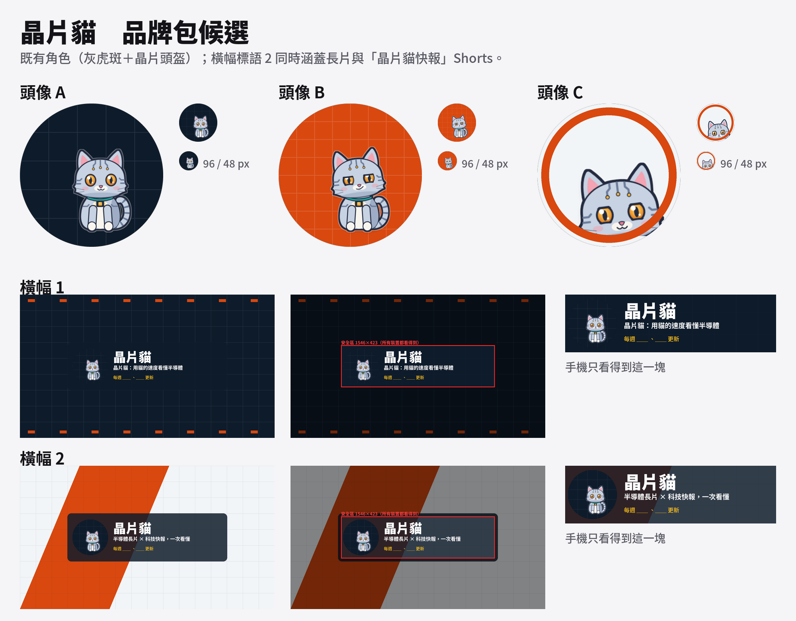
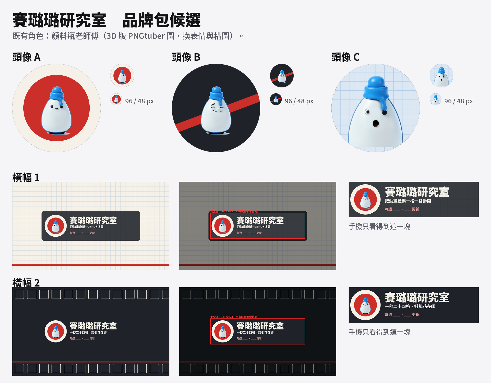
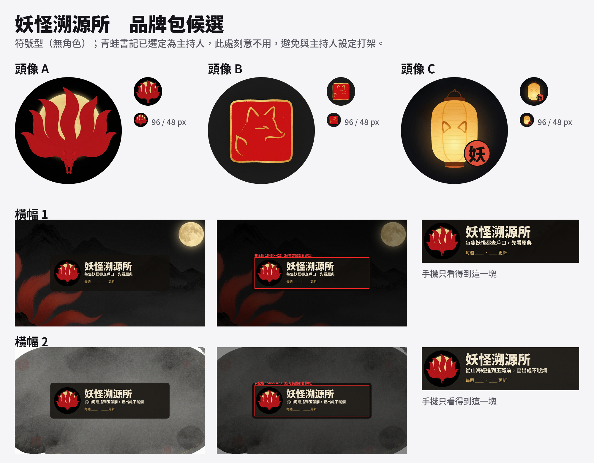
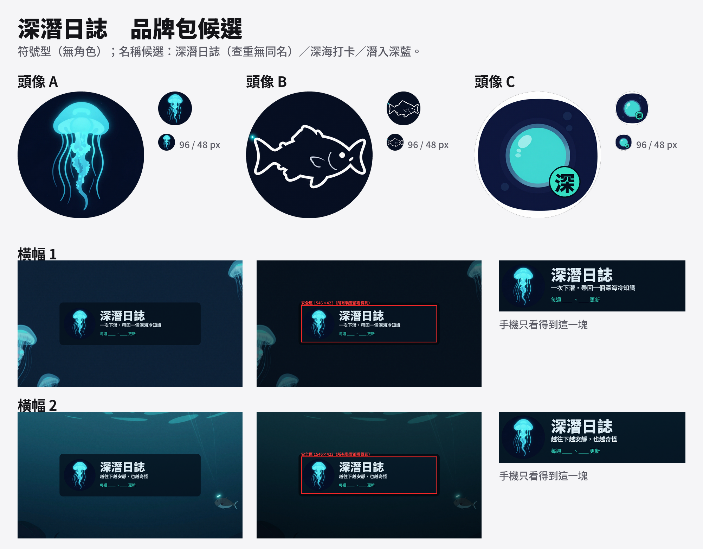
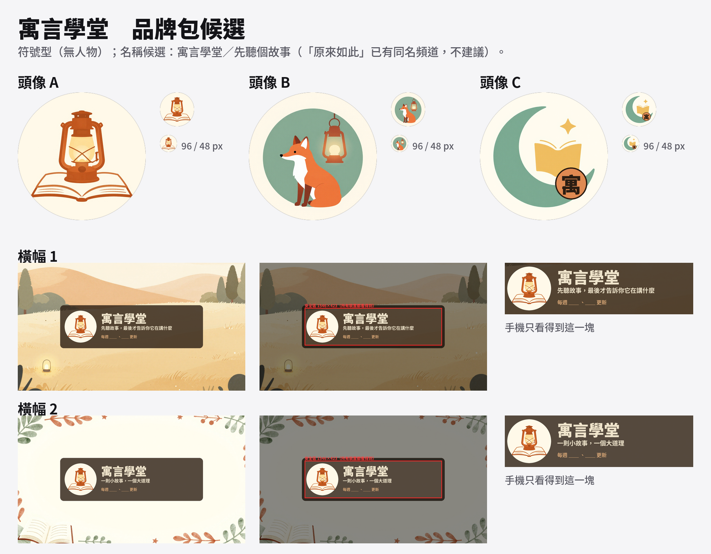

# 頻道品牌包候選（5 個頻道）

每個頻道：頭像 A/B/C（800×800，附圓形與 96/48 px 預覽）、橫幅 1/2（2560×1440，中央安全區 1546×423）、名稱查重。**全部是候選，沒有定案。**
科技新知已併入晶片貓（「晶片貓快報」Shorts 系列，Leon 2026-10-24），不另做品牌包。

| 頻道 | 拼版圖 | 頭像 | 橫幅（含安全區預覽） |
|---|---|---|---|
| 晶片貓 |  | `chipcat-avatar-{A,B,C}.png` | `chipcat-banner-{1,2}.png`／`-safe.png` |
| 賽璐璐研究室 |  | `cel-avatar-{A,B,C}.png` | `cel-banner-{1,2}.png`／`-safe.png` |
| 妖怪溯源所 |  | `yokai-avatar-{A,B,C}.png` | `yokai-banner-{1,2}.png`／`-safe.png` |
| 深潛日誌 |  | `deepsea-avatar-{A,B,C}.png` | `deepsea-banner-{1,2}.png`／`-safe.png` |
| 寓言學堂 |  | `fable-avatar-{A,B,C}.png` | `fable-banner-{1,2}.png`／`-safe.png` |

## 選項速覽

- **晶片貓**（既有灰虎斑＋晶片頭盔，用角色 rig 渲染）：A 深藍電路格＋坐姿／B 橘底＋得意表情／C 大頭特寫＋橘環。橫幅 1 標語「晶片貓：用貓的速度看懂半導體」，橫幅 2「半導體長片 × 科技快報，一次看懂」（涵蓋快報）。
- **賽璐璐研究室**（既有顏料瓶老師傅 3D 版）：A 奶油底＋紅圓／B 深色底＋紅斜帶＋得意臉／C 方格紙底＋驚訝特寫。橫幅 1 方格紙，橫幅 2 底片格。
- **妖怪溯源所**（符號型）：A 九尾狐剪影＋金月／B 朱紅印章／C 狐耳燈籠＋「妖」字章。橫幅 1 山月＋紅狐尾，橫幅 2 墨色紙面。
- **深潛日誌**（符號型）：A 發光水母／B 燈籠魚剪影／C 潛艇舷窗＋「深」字章。橫幅 1 水母，橫幅 2 光線＋燈籠魚。
- **寓言學堂**（符號型）：A 提燈＋繪本／B 小狐狸＋提燈／C 月牙＋書本＋「寓」字章。橫幅 1 草原＋提燈，橫幅 2 葉環。

橫幅右下的「每週 ＿＿ 、＿＿ 更新」是留空位，等上片節奏定了再填。

## 名稱查重（YouTube Data API search.list type=channel）

詳見 `name_check.json`；摘要與商標提醒在 `REPORT-brand-kit.md`。
